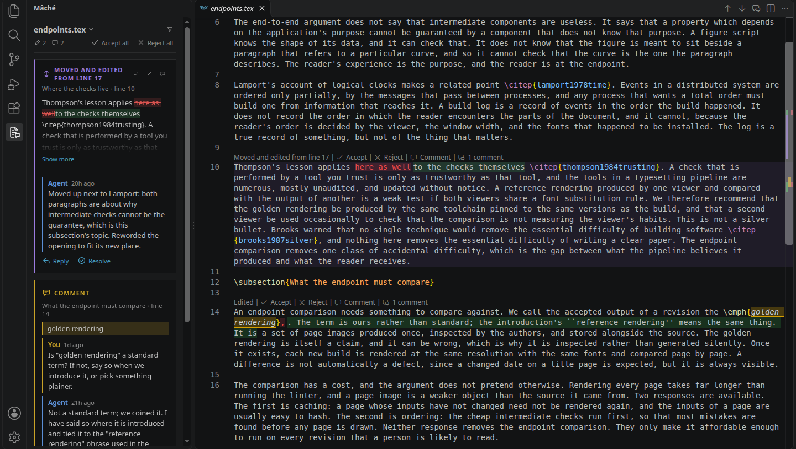
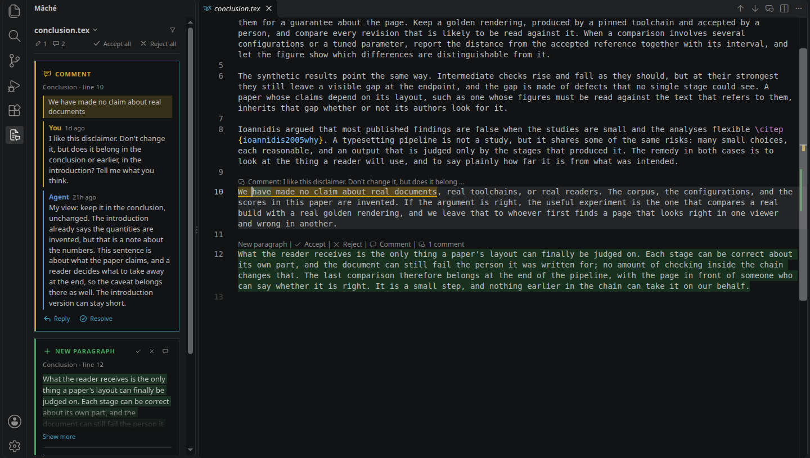

# Mâché

Write a LaTeX paper together with an AI agent, the way you would with a co-author in Google
Docs: its edits arrive as suggestions you can see, discuss, accept or reject, and nothing becomes
part of the paper until you say so.

## Install

You need [Node.js](https://nodejs.org) and VS Code.

```bash
npm install -g github:narunraman/mache   # the mache command
mache setup                              # the Mâché extension, in every VS Code on this machine
```

`mache setup` finds the `code` command and, if you connect to this machine with Remote-SSH or a
tunnel, the VS Code server here too; reload VS Code afterwards. (With
[kagaz](https://github.com/narunraman/kagaz), `kagaz new` and `kagaz setup` do both steps.) To
install by hand instead, `mache vsix` writes `mache.vsix` for Extensions → ⋯ → "Install from
VSIX…".

Mâché sets the editor settings it needs for LaTeX files itself. Two more make removed text red
and full length; `kagaz setup` adds them to a paper's workspace, or add them yourself:

```json
"workbench.colorCustomizations": { "editorInlayHint.foreground": "#f14c4c", "editorInlayHint.background": "#d73a4a30" },
"editor.inlayHints.maximumLength": 0
```

## The problem

Agents are good at editing prose, and asking one to tighten a section or answer a reviewer is
easy. Seeing what it actually did is not. In a `.tex` file a paragraph is usually one long line,
so `git diff` shows you this:

```diff
- Thompson's lesson applies here as well \citep{thompson1984trusting}. A check that is performed by a tool you trust is only as trustworthy as that tool, and the tools in a typesetting pipeline are numerous, mostly unaudited, and updated without notice. …
+ Thompson's lesson applies to the checks themselves \citep{thompson1984trusting}. A check that is performed by a tool you trust is only as trustworthy as that tool, and the tools in a typesetting pipeline are numerous, mostly unaudited, and updated without notice. …
```

Two whole paragraphs, to find that four words changed (and here the paragraph had also moved,
which a diff shows as one paragraph deleted and an unrelated one added). With code you mostly
care whether the tests pass; with a paper you care about every sentence, and you need to read
each change in context, push back on some, and keep the ones you like.

## What it looks like

Mâché keeps the text you have accepted and shows everything since as suggestions, right in the
`.tex` file you are editing:



- **Added words are green; removed words are red,** in place, wrapping like the rest of the line.
  Everything else is untouched text you can edit as usual.
- **A moved paragraph is one suggestion** ("Moved and edited from line 17", faint violet), with
  only its reworded words marked.
- **Above each change:** what it is, then Accept, Reject and Comment.
- **The panel** (the Mâché icon in the activity bar) lists every suggestion and comment in the
  file, with the same buttons.

Comments work like comments in Google Docs. Select text and press `Alt+M`; the text gets a yellow
underline, and the thread lives in the panel:



When the agent changes the text because of your comment, its edit appears inside its reply,
with its own Accept / Reject; **Accept & resolve** takes the edit and closes the conversation.

## How a round goes

1. **You write and comment.** Your own typing is just editing. (Turn on *Review mode* in the
   status bar if you want your edits shown as suggestions too.)
2. **You ask your agent**, in whatever chat you already use: "go through my comments", "tighten
   §3". Agents find their way in by running `mache` in the paper: it shows the comments waiting
   for a reply, newest first, and what they can do. There is nothing to configure for a
   particular agent; a paper's `AGENTS.md` only needs one line saying the paper is reviewed with
   `mache`.
3. **The agent edits the `.tex` files directly.** Its edits become suggestions. It answers your
   comments with `mache reply`, explains its other edits with `mache explain`, and can raise
   things of its own with `mache comment`.
4. **You review:** accept, reject, reply. A comment is *waiting* on the agent whenever you had
   the last word, so the next round picks up exactly where you left off.
5. **You commit** when a round feels done (see below).

The PDF always shows the current text, suggestions included, so you can read the draft as it
would be if you accepted everything.

## Two histories: every step privately, clean commits publicly

Mâché records everything as it happens: each agent edit, each accept and reject (with the agent's
reason), each comment and reply, and your own edits. That record lives in a private git history
inside `.review/`, which never leaves your machine.

```text
your repository (what you push)          private history (.review/, never pushed)

● Draft the paper
│                                               ● you comment on §4
│                                               ● agent edits §4 and replies
│                                               ● you accept the edit
│                                               ● agent adds a paragraph
│                                               ● you reject it
│               mache commit: squash, keeping   │
│               only the text you accepted      │
● Revise §4  ◀──────────────────────────────────┘
│                                               ● agent moves a paragraph in §2
│                                               ● you reply: "shorter?"
│                                               ● agent shortens it
│                                               ● you accept both
│               mache commit                    │
● Tighten §2  ◀─────────────────────────────────┘
```

Your paper's own repository sees none of that until you run `mache commit`. It squashes everything
since your last commit into **one commit containing only text you accepted**: pending suggestions
stay in your working files and out of your history. The commit message is drafted for you from the
round itself, mostly from the agent's own explanations:

```text
Revise Introduction, Experiments: 3 accepted, 1 rejected

- Introduction: define "golden rendering" where it is introduced.
- Experiments: give the actual rates (20% and 28%) instead of "roughly one in five".
- Experiments: split the long paragraph after the two numbers.

Rejected:
- Conclusion: new paragraph
```

It opens in your editor before anything is committed. You decide how much one commit covers (an
afternoon, a section, a reviewer's comments), so what you push is a short, readable history of
the paper, while the step-by-step record stays with you. `mache summary` shows the message
without committing. Keep `.review/` out of the repository (`.gitignore`).

## Commands

Run `mache` anywhere inside a paper. With no command it shows what is waiting; `mache help`
lists the rest.

| Command | What it does |
|---|---|
| `mache` | comments waiting for a reply (newest first), suggestions pending, what to do next |
| `mache comments [--waiting] [--all]` | comment threads, waiting ones first |
| `mache reply <id> "…"` | answer a comment; `--change <file>:<line>` names the edit that answers it |
| `mache comment <file>:<line> "…"` | start a thread on a line (`--quote "…"` to anchor on exact words) |
| `mache explain <file>:<line> "…"` | say why you made the edit at that line |
| `mache status` | every pending suggestion, per file (`--json` for scripts) |
| `mache start [files…]` | start reviewing files (default: every `.tex` file in the paper) |
| `mache summary` | the commit message for everything since the last commit |
| `mache commit` | commit the accepted text with that message (`--no-edit` to skip the editor) |
| `mache setup` | install the Mâché extension into this machine's VS Code |
| `mache vsix [file]` | write the extension package, to install by hand |

Messages are the agent's unless you add `--as user`. Accepting, rejecting and resolving are
deliberately not commands: those are the author's calls, made in the editor.

## In the editor

- **Accept / Reject** above a change, in the panel card, or with `Alt+Y` / `Alt+N` at the cursor;
  `Alt+]` / `Alt+[` move between suggestions. A paragraph with several separate edits lets you
  accept one of them from its hover.
- **Compare** (on rewritten paragraphs) opens the old paragraph above the new one, full width,
  beside the editor.
- **The panel's filter** shows everything, only suggestions (each change once, linking back to the
  comment it answers), or only comments, and whether resolved comments show. The file name opens
  a list of the paper's other files with pending work.
- **Your typing** is a normal edit and never turns green or red, unless Review mode is on. Typing
  inside an agent's green text edits that suggestion.

## Where things live

A paper has one `.review/` folder at its root:

```text
.review/README.md                          what this folder is, for whoever finds it
.review/paper/sections/model.tex           the accepted text of paper/sections/model.tex
.review/paper/sections/model.notes.json    its comment threads
.review/history.git                        the private step-by-step history
```

The root is the nearest folder above your files that has `.review/`; `mache start` creates it at
the paper's root (the folder with `kagaz.toml`, else the top of the git repository). Accepted
copies are only ever changed by your Accept, Reject or own edits; agents are told never to touch
the folder, and do not need to.

## Tests

```bash
npm test               # the comparison, comments and the mache command (Node only, a second or two)
npm run test:vscode    # the extension inside a real VS Code (set VSCODE_BIN if it is not found)
```

## Known limits

- A long deletion at the very start of a line is shown as a one-line summary (its full text is
  in the hover and the panel): VS Code mislays wrapped text inserted at a line's first column.
- Text typed directly onto the end of a suggested word, with no space, joins that suggestion.
- Mâché follows one person's review: co-authors editing at the same time are not supported yet.

